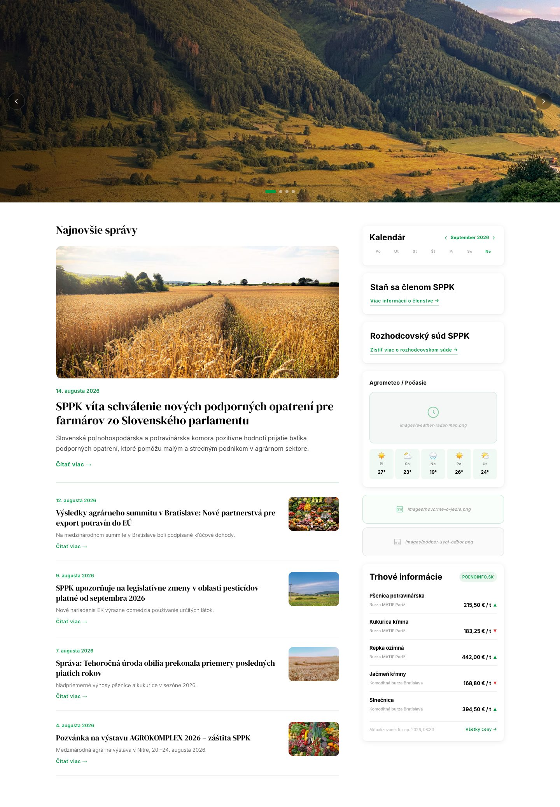
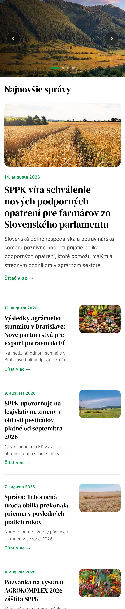
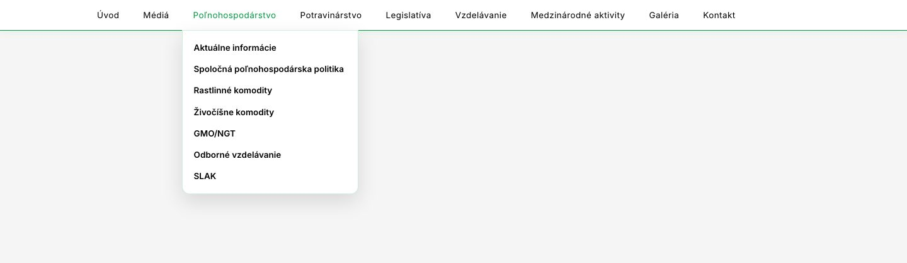
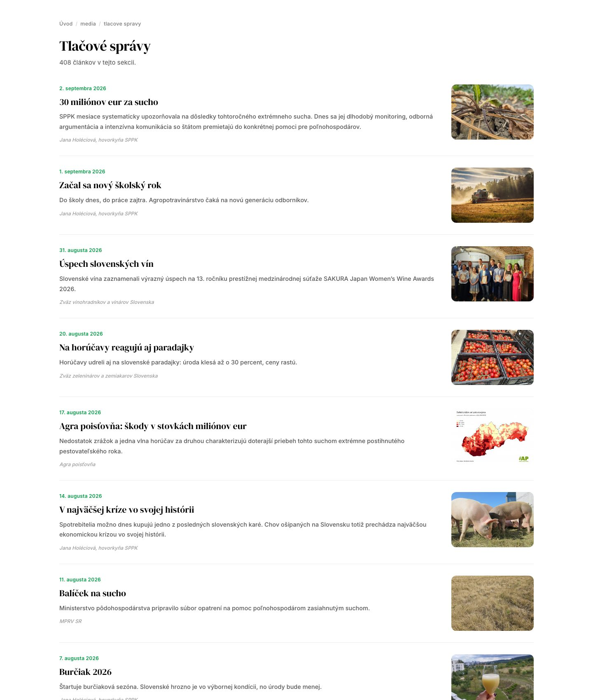
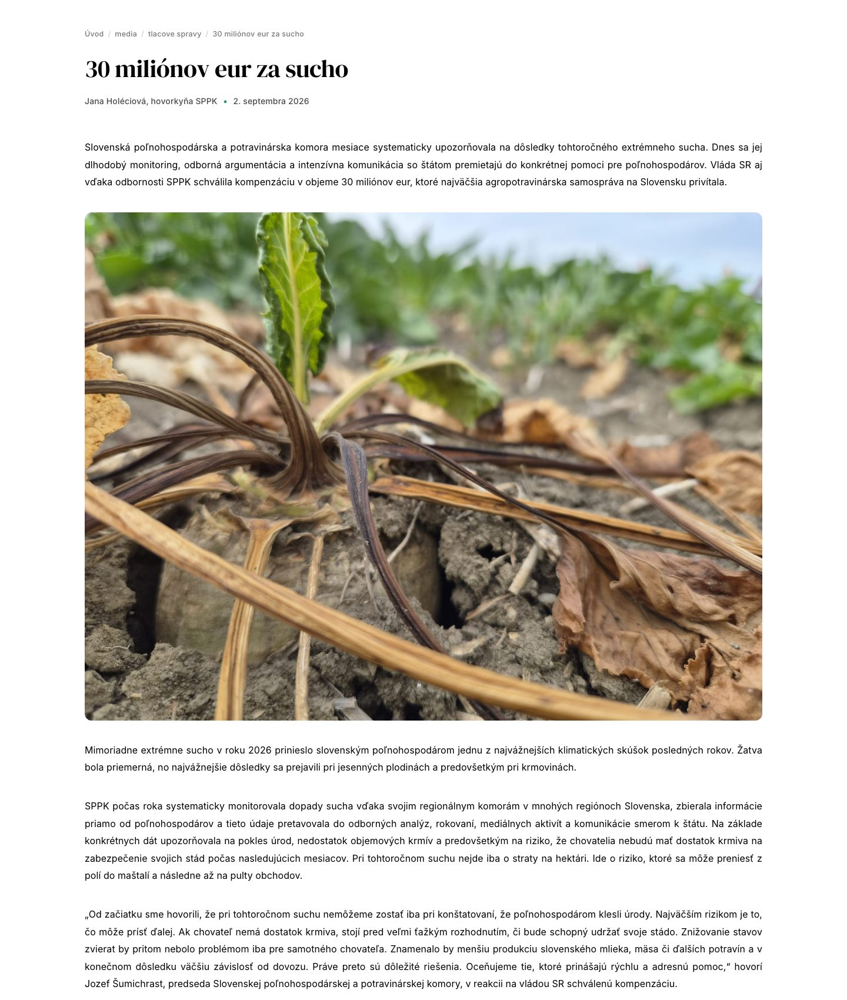

<div align="center">

# SPPK Website Redesign

**A complete redesign of the public website of the Slovak Chamber of Agriculture and Food**


<br>

<a href="https://bartolcic-webdesign.github.io/sppk-redesign">
  
</a>

<br><br>

[Take the tour](#take-the-tour) ·
[Explore the sections](#explore-the-sections) ·
[My role](#my-role) ·
[How it is built](#how-it-is-built) ·
[Privacy](#privacy-and-content)

<br>

<a href="docs/screenshots/01-home.jpg"></a>
&nbsp;&nbsp;
<a href="docs/screenshots/06-mobile-home.jpg"></a>

<sub>Desktop and mobile view of the home page. Click any image to see it in full size.</sub>

</div>

> [!NOTE]
> This is an independent portfolio copy of the project. It is **not** an official SPPK
> account or website. All organisation names, logos, articles and photographs belong to
> SPPK and their respective owners and are shown here only to demonstrate the redesign.

---

## At a glance

<table>
  <tr>
    <td align="center" width="25%"><h3>5,100+</h3><sub>pages</sub></td>
    <td align="center" width="25%"><h3>436</h3><sub>press releases</sub></td>
    <td align="center" width="25%"><h3>47</h3><sub>photo galleries</sub></td>
    <td align="center" width="25%"><h3>144</h3><sub>menu items, up to 5 levels deep</sub></td>
  </tr>
</table>

| | |
|---|---|
| **Client** | Slovak Chamber of Agriculture and Food (SPPK) |
| **When** | Summer 2026 |
| **Technology** | Plain HTML, CSS and JavaScript. No framework, no database. |
| **Language** | File and folder names in English. Page content in Slovak, the language of the site's readers. |

---

## Take the tour

Click a step to open it. Each one shows a screenshot and a link to the same page on the
live website.

<details open>
<summary><b>1 · Home page</b>: news, calendar, weather and market prices</summary>
<br>

The first thing every visitor sees. A large image slider, the latest news on the left,
and quick information on the right: a calendar of events, a weather forecast and current
market prices of crops.

<table>
  <tr>
    <td align="center" valign="top">
      <a href="docs/screenshots/01-home.jpg"></a><br>
      <sub>Desktop</sub>
    </td>
    <td align="center" valign="top">
      <a href="docs/screenshots/06-mobile-home.jpg"></a><br>
      <sub>Phone</sub>
    </td>
  </tr>
</table>

**[Open the home page &rarr;](https://bartolcic-webdesign.github.io/sppk-redesign/)**

</details>

<details>
<summary><b>2 · Navigation</b>: 144 menu items in one menu</summary>
<br>

The whole website fits into one menu. To keep it readable, a section first shows only
its main subsections. Deeper levels open when the pointer moves onto their parent,
marked with an arrow.

<a href="docs/screenshots/05-menu.jpg"></a>

**[Try the menu &rarr;](https://bartolcic-webdesign.github.io/sppk-redesign/components/menu/)**

</details>

<details>
<summary><b>3 · Press releases</b>: the main entry point for journalists</summary>
<br>

All 436 press releases in one clear list, newest first, each with a date, a title, a
short summary and a picture.

<a href="docs/screenshots/02-press-releases.jpg"></a>

**[Browse the press releases &rarr;](https://bartolcic-webdesign.github.io/sppk-redesign/pages/media/press-releases/)**

</details>

<details>
<summary><b>4 · Article page</b>: content moved over from the old website</summary>
<br>

Every article from the old website was moved into the new design: a lead paragraph, a
line with the author and date, centred images and easy-to-read text.

<a href="docs/screenshots/03-article.jpg"></a>

**[Read an article &rarr;](https://bartolcic-webdesign.github.io/sppk-redesign/pages/media/press-releases/)**

</details>

<details>
<summary><b>5 · On a phone</b>: the same website on a small screen</summary>
<br>

On a phone, the layout changes to a single column so that everything stays readable
without zooming.

<a href="docs/screenshots/06-mobile-home.jpg"></a>

**[Open it on your phone &rarr;](https://bartolcic-webdesign.github.io/sppk-redesign/)**

</details>

---

## Explore the sections

Jump straight into any part of the live website:

| Section | What you will find | |
|---|---|---|
| **Media** | press releases, press conferences, spokesperson | [Open &rarr;](https://bartolcic-webdesign.github.io/sppk-redesign/pages/media/) |
| **Agriculture** | crops, livestock, common agricultural policy | [Open &rarr;](https://bartolcic-webdesign.github.io/sppk-redesign/pages/agriculture/) |
| **Food industry** | statistics, food retail, EFSA reports | [Open &rarr;](https://bartolcic-webdesign.github.io/sppk-redesign/pages/food-industry/) |
| **Legislation** | Slovak legislation, SPPK documents | [Open &rarr;](https://bartolcic-webdesign.github.io/sppk-redesign/pages/legislation/) |
| **Education** | vocational schools, dual education | [Open &rarr;](https://bartolcic-webdesign.github.io/sppk-redesign/pages/education/) |
| **International** | COPA-COGECA, EESC, V4, reports from Brussels | [Open &rarr;](https://bartolcic-webdesign.github.io/sppk-redesign/pages/international/) |
| **Gallery** | 47 photo galleries | [Open &rarr;](https://bartolcic-webdesign.github.io/sppk-redesign/pages/gallery/) |
| **Contact** | board, office, regional chambers | [Open &rarr;](https://bartolcic-webdesign.github.io/sppk-redesign/pages/contact/) |

---

## The challenge

SPPK's website has to work for two very different groups of people:

<table>
  <tr>
    <td width="50%" valign="top">
      <h3>Journalists</h3>
      Need the latest press releases, official statements and the right contact,
      quickly and on deadline.
    </td>
    <td width="50%" valign="top">
      <h3>Farmers and food producers</h3>
      Look for legislation, market prices, subsidies, statistics, events and practical
      guidance for their business.
    </td>
  </tr>
</table>

**The approach:** keep the existing structure of the site, so that returning visitors
still find everything where they expect it, and give it a completely new, modern and
readable look.

---

## My role

The project was developed with a collaborator. My part was:

<table>
  <tr>
    <td width="50%" valign="top">
      <h4>Design</h4>
      The new look of the pages: layout, typography, colours and content cards.
    </td>
    <td width="50%" valign="top">
      <h4>HTML</h4>
      The page code and the shared components: header, menu and footer.
    </td>
  </tr>
  <tr>
    <td width="50%" valign="top">
      <h4>Content migration</h4>
      Moving articles, press releases, contacts and documents from the old site into
      the new structure.
    </td>
    <td width="50%" valign="top">
      <h4>Gallery fix</h4>
      Repairing the photo galleries so that albums and images load and display
      correctly.
    </td>
  </tr>
</table>

---

## How it is built

<details>
<summary><b>Folder structure</b></summary>
<br>

```
sppk-redesign/
├── index.html            entry point: the home page
├── README.md             this file
├── assets/
│   └── images/           images shared by the whole site (logos, partners)
├── components/           parts that appear on every page
│   ├── header/           logo, search, language switch
│   ├── menu/             main navigation (144 items)
│   └── footer/           partners and legal footer
├── pages/                the content, one folder per section
│   ├── home/             news, projects, about the chamber
│   ├── media/            press releases, press conferences, spokesperson
│   ├── contact/          board, office, regional chambers, associations
│   ├── legislation/      Slovak legislation, SPPK documents, GDPR
│   ├── agriculture/      crops, livestock, common agricultural policy
│   ├── food-industry/    statistics, food retail, EFSA
│   ├── education/        vocational schools, dual education
│   ├── international/    COPA-COGECA, EESC, V4, Brussels reports
│   └── gallery/          photo galleries
└── docs/
    └── screenshots/      images used in this README
```

</details>

<details>
<summary><b>Key decisions and why</b></summary>
<br>

| Decision | Why |
|---|---|
| **One page = one folder** with its own `index.html` | Clean web addresses such as `/pages/media/press-releases/`, and each page keeps its images next to it. |
| **Shared components** in `components/` | The header, menu and footer are written once and attached to every page, so a change is made in one place. |
| **English folder names, Slovak content** | Developers can find their way around the code; readers get the site in their own language. |
| **URL-safe names** (lowercase, no spaces or accents) | Article folders are short versions of the original Slovak titles that work in any browser and on any server. |
| **Relative links only** | The site works from any folder and on GitHub Pages without any server setup. |
| **No framework, no database** | The site is fast, easy to host and will keep working for years without updates. |

</details>

<details>
<summary><b>Run it on your computer</b></summary>
<br>

No installation is needed. Download the repository and open `index.html` in a browser,
or serve the folder:

```bash
python -m http.server 8000
```

Then open http://localhost:8000.

</details>

---

## Privacy and content

> [!IMPORTANT]
> - **Only public content.** This copy contains only content that was already publicly
>   available on the SPPK website. Members-only sections and texts intended for members
>   were not included.
> - **GDPR.** I asked SPPK about publishing this copy so that it would comply with GDPR.
> - **Contact details replaced.** All e-mail addresses were replaced with
>   `meno@example.com` and all phone numbers with `+421 XXX XXX XXX`.

Search and the login form are visual only. They need a backend, which is not part of
this static copy.

---

<div align="center">
<br>
<a href="https://bartolcic-webdesign.github.io/sppk-redesign"><b>Open the live website &rarr;</b></a>
<br><br>
<sub>Portfolio project · SPPK website redesign · 2026</sub>
</div>
